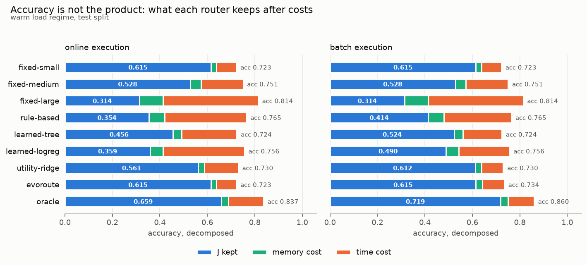

# EvoRoute

**ローカル LLM 間のタスクルーティングを、進化的探索で最適化できるか検証したプロジェクト**

3 つのローカルモデル（Qwen2.5 1.5B / 3B / 7B）に対し、タスクごとに実行モデルを選ぶ
ルーターを 5 方式実装し、精度だけでなく **ロード時間・常駐メモリ・切り替え回数** を含む
単一の目的関数で比較した。

## 結論

**進化的探索は、最小モデルを常に使う方式を上回らなかった。** ただし本プロジェクトの
中身は、なぜ上回らなかったかを測定したことにある。

```
                     online 実行                  batch 実行
cold ロード    ties single (+0.0000)        ties single (+0.0000)
               到達     0.0%                到達     −1.6%
               表現上限 0.0%  ←              表現上限 31.2%

warm ロード    ties single (+0.0000)        ties single (+0.0004)
               到達     0.0%                到達      0.4%
               表現上限 3.4%                表現上限 33.5%
```

**「表現上限」はテスト分割の上で直接フィッティングした値**——手法ではなく測定器である。
これにより 2 種類の失敗が区別できる。

- **cold/online: 表現上限が 0.0%。** 特徴量が足りないのではなく、
  **ルーティングという問題に解くべき中身がない。** この条件では Oracle（完璧なルーター）
  ですらベースラインと統計的に区別できない（+0.0014、95% CI [−0.0133, +0.0014]）。
- **batch: 表現上限 33.5% に対し到達 0.4%。** こちらは汎化の失敗。
  GA も決定木もリッジも、300 件の訓練データからその規則を見つけられない。

**留保**: 表現上限はテスト分割の上でフィッティングした値なので、テスト過学習を含む上界である
（batch では J(train) 0.6182 < J(test) 0.6496 で、それが直接見える）。
訓練データを 60→300 件に増やした学習曲線は、天井ではなくベースラインに収束する。
本プロジェクトは「進化的探索が勝てなかった」ことは示すが、
**「原理的に勝てない」ことは示していない。**

詳細は **[技術レポート](docs/report.md)** を参照。



最も精度が高いルーターが、最も目的関数を失う。`fixed-large` は精度 0.814 で最高、
J は 0.314 で最低。ローカル実行ではロード時間が推論時間の 4〜11 倍かかるため、
精度のために払うコストが精度の価値を上回る。

## 設計上の判断

### 応答行列：1,800 回の推論で全実験をまかなう

全 (タスク × モデル) の組を 1 回だけ実測し、以降のルーター評価も進化的探索の適応度計算も
すべて辞書引きにした。GA 1 回の実行は 3,600 回の適応度評価 = 108 万回のタスク評価であり、
素朴な実装なら **GA 1 回に 140 時間以上の推論**がかかる。
行列化により **GA 1 実行 = 0.48 秒**、40 回の GA 実行を含む比較表全体が 26 秒で終わる。

### 目的関数：提案時の定義を破棄した

```
J = Accuracy − w_time·(inference_ms + load_ms)/time_ref − w_mem·(mean_resident_mb)/mem_ref
```

切り替えペナルティを独立項として正規化すると、`switch_ref` がロード時間に比例して動き、
**ロードを 6 倍高価にしても最適解が変わらない**。正規化が、測ろうとしていたコストを
打ち消していた。推論時間とロード時間を先に足してから一度だけ正規化する。
回帰テストで固定している。

### 表現上限：意図的にカンニングする測定器

`evoroute-ceiling*` はテスト分割の上で直接フィッティングする。手法としては不正だが、
**「この特徴量で書ける規則は、そもそもどこまで到達し得るか」**は正直なルーターには
答えられない問いであり、これがないと negative result は「探索が下手だった」と
区別できない。

### 統計：移動ブロックブートストラップ

J はタスクの平均ではない。online では連続するタスクの tier が変わるたびにロードを課金する
ため、統計量が**系列に依存する**。タスクを独立に復元抽出すると信頼区間が自身の点推定を
含まなくなる（重複タスクが隣接し、切り替えが起きない位置に入るため）。連続ブロックを
抽出することで切り替え回数の局所構造を保存している。

## 使い方

### 解析だけを再現する（推論不要）

測定結果は `data/measurements.json.gz`（129 KB）に同梱してある。

```bash
uv sync
evoroute import-snapshot    # 1,800 セルの応答行列を復元
evoroute baseline           # 以降すべて数秒
```

Docker でも同じことができる。

```bash
docker build -t evoroute . && docker run --rm evoroute
```

**測定部分は意図的にコンテナ化していない。** `profile` と `bench` は
モデルのロード時間と OS ページキャッシュを計測するが、macOS の Docker は Linux VM 上で
動くため、測定対象そのものが歪む。再測定はホストで行う。

### 測定からやり直す

```bash
uv sync
ollama serve &
ollama pull qwen2.5:1.5b-instruct-q4_K_M
ollama pull qwen2.5:3b-instruct-q4_K_M
ollama pull qwen2.5:7b-instruct-q4_K_M
```

| コマンド | 内容 | 時間 |
|---------|------|------|
| `evoroute ingest` | データセット取得・プロンプト生成・train/test 分割 | 数十秒 |
| `evoroute profile --repeats 5 --purge` | ロード時間（warm / cold）と常駐メモリ | 1 分 |
| `evoroute bench` | 応答行列 1,800 セルを実測（**再開可能**） | 約 7 分 |
| `evoroute baseline` | 5 方式 × 実行モード × ロード機構の比較表 | 26 秒 |
| `evoroute stats` | ブートストラップ CI と到着順感度 | 25 秒 |
| `evoroute cascade` | 入力のみ vs カスケード、sklearn 対照実験 | 27 秒 |
| `evoroute learning-curve` | 訓練データ量を変えたときの到達値 | 9 秒 |
| `evoroute figures` | 図 3 枚を再描画 | 1.4 秒 |
| `evoroute refresh --dataset X` | プロンプトを再生成し、影響したセルだけ無効化 | 即時 |
| `evoroute export` / `import-snapshot` | 測定結果の書き出し・復元 | 即時 |

`bench` 以外はすべてキャッシュ済み行列を読むだけである。`bench` は中断しても
`UNIQUE (task_id, tier, repeat_idx)` により完了済みセルをスキップして再開する。
`--purge` は cold ロード測定のため `sudo purge` を実行する（パスワード入力が必要）。

```bash
pytest          # 67 テスト。最適解は全探索と照合して検証している
```

## 構成

```
src/evoroute/
  config.py        モデル定義、目的関数の重み、データセット仕様
  db.py            SQLite スキーマ。runs が密な (タスク×モデル) 行列
  objective.py     J の定義、実行順序、動的計画法による厳密最適解
  features.py      入力のみの特徴量 11 個 + カスケード特徴量 8 個
  stats.py         移動ブロックブートストラップ、到着順感度
  viz.py           図 3 枚
  datasets/        AG News / CoNLL-2003 / ARC-Easy のローダとプロンプト
  evaluation/      Ollama 実測ハーネス、採点
  models/          Ollama クライアント（ロード時間と推論時間を分離して取得）
  routers/         fixed / rule_based / learned / evolved / oracle
  evolution/       ゲノム表現、変異・交叉、GA 本体
tests/             67 テスト
data/
  measurements.json.gz  応答行列のスナップショット（再現用）
Dockerfile         解析の再現環境（測定は対象外）
docs/
  proposal.md      当初の研究計画
  report.md        技術レポート
results/figures/   図
```

## 技術スタック

Python 3.11+ / Ollama / scikit-learn / NumPy / SQLite / matplotlib / typer / pytest

## 既知の限界

- 訓練データが 300 件。batch の表現上限が到達不能な主因である可能性が高い。
- モデル 3 つがすべて同一ファミリ・同一量子化。単調なフロンティアを作るための選択だが、
  その結果モデル間の相補性が乏しい。量子化軸は範囲外（レポート 2.1 節）。
- 測定は単一マシン・単一試行。推論は `temperature=0, seed=0` で決定的。
- Oracle はタスクの到着順に固有である（レポート 5.2 節）。
